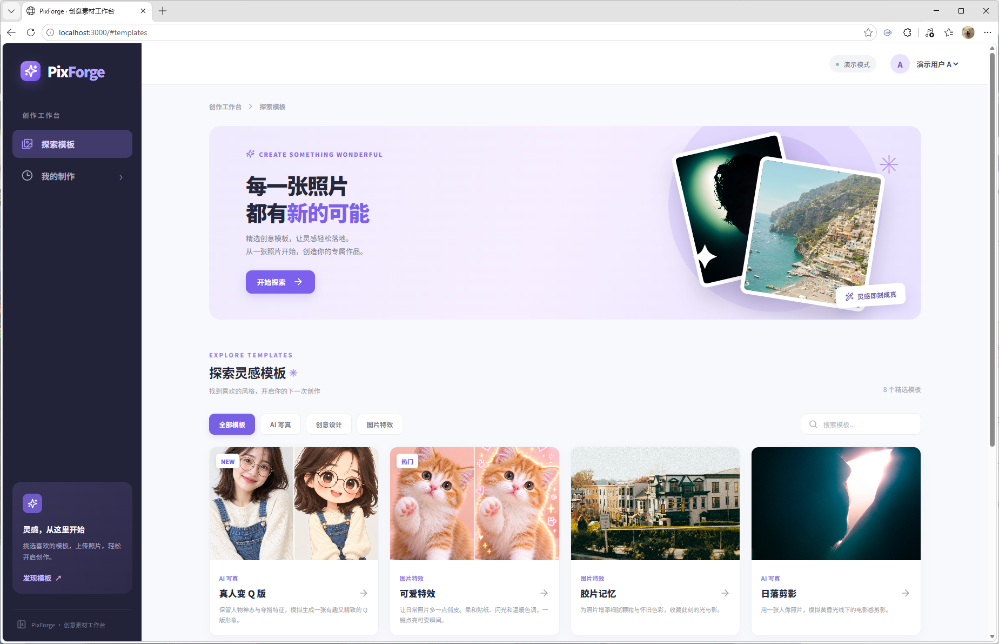

# PixForge



基于 Next.js、Spring Boot、MyBatis 和 MySQL 的图片素材创作工作台。用户可浏览模板、上传图片并提交异步制作任务；任务在 Java 后台处理，历史记录、阶段状态和图片由服务端保存。生成器只做可控制耗时的模拟：旅行明信片把 1–3 张上传图片拼成结果图，其他模板复制第一张图片，不调用 AI。

## 完成范围

- 8 个数据库种子模板，支持分类筛选、详情和不同素材数量要求；旅行明信片可上传 1–3 张图片。
- 后端校验并保存 JPEG/PNG 图片；按演示用户隔离素材、任务和结果访问。
- Java 事务中创建任务与三个阶段，提交返回 HTTP 202；固定大小线程池后台按“素材检查 → 模拟生成 → 结果整理”执行，可指定阶段失败和耗时。
- 任务与阶段写入 MySQL，支持分页历史、进行中/已完成/制作失败独立查询及单任务查询；队列满和服务重启遗留任务会记录失败原因。
- 前端默认使用真实 Java API，提供上传反馈、多任务追踪、请求错误保留旧数据、刷新恢复和演示用户切换。设置 `NEXT_PUBLIC_USE_DEMO_API=true` 可使用仅存于浏览器的独立演示适配器。

## 技术版本与结构

| 部分 | 版本 / 位置 |
| --- | --- |
| 前端 | Next.js 16.4.3、React 19.3.1、TypeScript 5.9.3；`frontend/` |
| 后端 | Java 17、Spring Boot 3.3.5、MyBatis starter 3.0.4；`backend/` |
| 数据库 | MySQL 8.0；`backend/src/main/resources/schema.sql` 和 `data.sql` |
| 素材 | `assets/templates/` 原始演示素材，`frontend/public/templates/` 运行时副本；来源见 [素材来源](assets/SOURCES.md) |
| 容器编排 | [`compose.yml`](compose.yml)、[`frontend/Dockerfile`](frontend/Dockerfile)、[`backend/Dockerfile`](backend/Dockerfile) |
| CI | [GitHub Actions](.github/workflows/ci.yml) |

前端依赖及锁定版本见 [`frontend/package.json`](frontend/package.json) 和 [`frontend/package-lock.json`](frontend/package-lock.json)；后端依赖见 [`backend/pom.xml`](backend/pom.xml)。页面采用 Next.js App Router；业务 API、异步执行和 MySQL 持久化位于 Java 后端，Next.js 仅通过同源代理转发 `/api/*` 请求。前端用 React 状态管理上传和任务列表，用轮询更新进行中的任务；后台用有界线程池执行。

## 克隆与启动（Docker Compose）

先安装 Git 和 Docker Compose，并确认 Docker 引擎已启动、宿主机的 3000 和 8080 端口可用。Windows 使用 Docker Desktop 的 Linux 容器模式；Linux 使用 Docker Engine 与 Compose 插件。以下命令会从 GitHub 克隆源码，在项目目录构建并启动 MySQL、Java 后端和 Next.js 前端。

### Windows（PowerShell）

```powershell
git clone https://github.com/shisan6688/PixForge.git
Set-Location PixForge
docker compose up --build -d
```

### Linux（Bash）

```bash
git clone https://github.com/shisan6688/PixForge.git
cd PixForge
docker compose up --build -d
```

两种系统均可用 `docker compose ps` 检查服务状态。前端访问 `http://localhost:3000`，后端健康检查为 `http://localhost:8080/api/health`。首次启动时后端自动建表并写入演示用户 A/B 和 8 个模板；后续启动会按 UTF-8 更新种子数据的展示文案。MySQL 数据和上传文件分别保存在 `mysql_data`、`uploads_data` 卷。停止服务用 `docker compose down`，该命令不会删除卷；需要保留历史时不要加 `-v`。Compose 中的数据库密码只用于本地演示，不应用于公网部署。

### 不使用 Docker 的本机运行

Windows 和 Linux 都需要 Node.js 22、npm、JDK 17、Maven 3.9 和 MySQL 8.0。先在 MySQL 中创建数据库及用户，例如：

```sql
CREATE DATABASE pixforge CHARACTER SET utf8mb4 COLLATE utf8mb4_unicode_ci;
CREATE USER 'pixforge'@'localhost' IDENTIFIED BY 'pixforge';
GRANT ALL PRIVILEGES ON pixforge.* TO 'pixforge'@'localhost';
```

从仓库根目录打开第一个终端启动后端：

```bash
cd backend
mvn test package
java -jar target/pixforge-service.jar
```

从仓库根目录打开第二个终端启动前端：

```bash
cd frontend
npm ci
npm run dev
```

生产模式的前端构建与启动命令为 `cd frontend && npm ci && npm run build && npm run start`；后端构建和启动命令见上方。完整检查命令见“验证与限制”。本机执行时，Windows 在 PowerShell 用 `$env:变量名="值"` 设置后端环境变量，Linux 在 Bash 用 `export 变量名="值"`；环境变量需在启动对应服务的终端中生效。

前端通过 Next.js 同源代理访问 Java；本机代理默认指向 `http://localhost:8080`。在其他地址运行后端时设置 `BACKEND_URL`。生产构建须在**构建时**提供此变量（Compose 已通过前端构建参数传入）；开发服务器启动前设置即可。前端默认调用真实接口；`NEXT_PUBLIC_USE_DEMO_API` 也是构建期变量，改变后须重新构建。`frontend/.env.example` 将演示适配器设为 `true`，复制使用后会切换为仅存于浏览器的模式；要验证 Java/MySQL 业务链路，应设为 `false`。

本机配置示例（仅供本地演示，无真实凭据；Compose 已配置等价的容器内地址）：

```text
# 后端环境变量；数据库用户与上方 SQL 示例相同
DB_URL=jdbc:mysql://localhost:3306/pixforge?useUnicode=true&characterEncoding=utf8&connectionTimeZone=UTC&forceConnectionTimeZoneToSession=true
DB_USER=pixforge
DB_PASSWORD=pixforge
STORAGE_ROOT=./data
DEMO_CONTROLS_ENABLED=true
WORKER_COUNT=2
QUEUE_CAPACITY=16
PORT=8080

# 前端环境变量，可写入 frontend/.env.local
BACKEND_URL=http://localhost:8080
NEXT_PUBLIC_USE_DEMO_API=false
```

后端默认数据库地址为 `localhost:3306/pixforge`，上传目录为 `./data`，工作线程 2 个、等待队列 16 个。Spring Boot 启动时按 UTF-8 执行 [`schema.sql`](backend/src/main/resources/schema.sql) 和 [`data.sql`](backend/src/main/resources/data.sql)：前者建表，后者写入演示用户 A/B 与 8 个模板；已有种子记录的展示文案会更新。模板封面和效果预览是仓库自带的 [`frontend/public/templates/`](frontend/public/templates/) 静态文件，由前端服务提供；其原始素材与来源记录在 [`assets/templates/`](assets/templates/) 和 [素材来源](assets/SOURCES.md)。无需另行下载图片。用户上传的素材及制作结果由后端写入 `STORAGE_ROOT`，Compose 使用 `uploads_data` 卷保存。

## 演示

其他界面截图：[模板列表与分类](./附件/UI-01：模板列表与分类.png) · [模板详情与上传位](./附件/UI-02：普通模板详情与上传位.png) · [制作中与历史结果](./附件/UI-03：制作中与历史结果.png)。

1. 在首页筛选模板，进入详情并上传要求数量的 JPEG/PNG 图片（每张不超过 5 MB）。
2. 展开“演示设置”，将每阶段耗时设为 1、2、4 或 8 秒。选择“不模拟失败”演示成功；选择素材检查、模拟生成或结果整理可重复触发相应阶段失败。提交后立即进入“我的制作”。
3. 制作期间继续提交其他任务，观察排队和各阶段状态。刷新历史页后记录从 MySQL 恢复，未完成任务继续轮询。“我的制作”可分别查看全部作品、制作中、已完成和制作失败；各标签数量由服务端统计。
4. 右上角切换演示用户 A/B，验证各自只能查看自己的任务和图片。

`DEMO_CONTROLS_ENABLED=false` 时，Java 拒绝带有 `simulation` 对象的提交请求；此配置适用于不开放演示控制的环境。当前前端始终会提交该对象，关闭演示控制时需同步调整前端请求。

## 接口与状态

| 方法 | 路径 | 作用 |
| --- | --- | --- |
| GET / POST | `/api/demo/session` | 获取或切换演示用户；POST 请求为 `{"demoKey":"A"}` 或 `B` |
| GET | `/api/templates?category=...`、`/api/templates/{id}` | 分类、模板列表及详情 |
| POST | `/api/assets` | `multipart/form-data` 字段 `file`；返回 `id`、`previewUrl`、文件信息 |
| GET | `/api/assets/{id}/content` | 预览本人图片 |
| POST | `/api/tasks` | 返回 HTTP 202 和任务快照；请求示例见下方 |
| GET | `/api/tasks?page=0&size=20` | 个人历史，返回 `items`、当前筛选的 `total`、`page`、`size` 和各状态 `counts` |
| GET | `/api/tasks?status=ACTIVE` | 只查询 `QUEUED` / `RUNNING` |
| GET | `/api/tasks?status=SUCCEEDED` | 只查询已完成任务 |
| GET | `/api/tasks?status=FAILED` | 只查询制作失败任务 |
| GET | `/api/tasks/{id}`、`/api/tasks/{id}/result` | 任务详情或本人成功图片 |

`GET /api/demo/session` 返回 `id`、`demoKey`、`displayName`；切换用户时 `POST` 发送 `demoKey`，返回相同字段。模板列表返回 `categories` 和 `items`，详情与每个列表项包含 `id`、`title`、`category`、`description`、`coverUrl`、`resultSampleUrl`、`requiredImageCount`、`maxImageCount`、`acceptedMimeTypes`、`maxFileSizeBytes`、`accent`、`badge`。上传接口接收表单字段 `file`，返回 `id`、`previewUrl`、`originalFilename`、`mimeType`、`sizeBytes`；`previewUrl` 和成功任务的 `resultUrl` 均指向需要当前用户会话的图片接口。

```json
{
  "templateId": "travel-postcard",
  "assetIds": ["已上传素材的 UUID 1", "已上传素材的 UUID 2"],
  "simulation": { "failAtStage": "GENERATE", "stepDelayMs": 2000 }
}
```

`POST /api/tasks` 接收 `templateId`、按上传位顺序排列的 `assetIds` 和可选的 `simulation`；其中 `failAtStage` 可为 `CHECK_ASSETS`、`GENERATE`、`FINALIZE` 或 `null`，`stepDelayMs` 为每阶段 0–10000 毫秒。不传 `simulation` 时默认每阶段 2000 毫秒且不失败。服务端校验模板、素材归属、数量、格式和大小，在事务提交后将任务交给 Java 线程池，立即返回 HTTP 202 与任务快照；查询接口只读取服务端状态，不推进任务。

未提供 `status` 时查询全部任务；`page` 从 0 开始，`size` 为 1–100，`counts` 包含当前用户的 `all`、`active`、`succeeded` 和 `failed`，不受当前页大小限制。整体状态为 `QUEUED → RUNNING → SUCCEEDED / FAILED`，阶段为 `CHECK_ASSETS → GENERATE → FINALIZE`。每阶段保存独立的 `PENDING / RUNNING / SUCCEEDED / FAILED` 状态、时间和失败原因；失败后后续阶段保持 `PENDING`，终态不会因查询回退。任务查询返回 `id`、`templateId`、`templateTitle`、`templateCoverUrl`、`status`、`currentStage`、`steps`、带 UTC 偏移的 `createdAt`、`resultUrl`、`failureCode`、`failureMessage`；`steps` 中每项包含 `stage`、`status`、`failureCode`、`failureMessage`。错误响应包含 `code` 和 `message`，字段校验错误还包含 `fields`。

Java 的 HTTP 会话决定当前演示用户，浏览器通过会话 Cookie 延续身份；新会话默认为 A，POST 会话接口可切至 B。后端以当前用户 ID 查询或写入素材、任务和结果；历史记录保存在 MySQL，刷新后可恢复。不存在或不属于当前用户的私人资源统一返回 404。前端仅在有进行中任务时轮询列表，离开页面或切换用户时中止旧请求；查询异常保留最近的任务数据，并可手动重新查询。只有服务端任务状态为 `FAILED` 才显示制作失败。

## 验证与限制

在 `frontend/` 运行 `npm run lint`、`npm run typecheck`、`npm run test`、`npm run build`；在 `backend/` 运行 `mvn test package`。[CI](.github/workflows/ci.yml) 在 push 和 pull request 时执行这些检查。Windows 本机 Maven 若遇跨盘符 Surefire 启动问题，可加 `-DforkCount=0`。后端单元测试覆盖阶段顺序、三个指定失败阶段的中断、终态保护和用户任务隔离；前端测试覆盖任务互不串扰、查询异常和任务失败的区分，以及上传数量校验。

此前在本机完成过 Java 单元测试与打包、前端 lint、类型检查、测试和构建。临时 MySQL 8.0 实例上的 HTTP 验证覆盖建表及 8 个种子模板、上传、成功与指定阶段失败、结果读取、用户隔离和重启中断；生产构建的 Next.js 同源代理也通过上传及任务提交验证。数据库和 HTTP 全流程尚无自动集成测试；Docker Compose 镜像构建与容器启动已完成手工验证。

未完成与已知限制：旅行明信片仅按固定布局拼接图片，其他模板的成功结果复制第一张素材；运行时不调用 AI。演示用户会话与执行器均为单实例设计，不适合横向扩容，也没有正式身份系统。重启后上次遗留的 `QUEUED` / `RUNNING` 任务会被标记为 `SERVICE_INTERRUPTED`，不会自动恢复执行；已受理任务在队列满时标记为 `EXECUTOR_OVERLOADED`。数据库表结构通过启动 SQL 初始化，尚无版本化迁移，已有表不会自动升级。上传文件与数据库记录的写入并非一个原子事务，存储故障可能留下孤立文件。生产部署需另配独立凭据和持久化存储。

## 部署与回滚

部署前记录当前 Git commit 或镜像版本，备份 MySQL 数据和 `uploads_data` 上传卷。确认环境变量、数据库连接和卷挂载后，按上面的 Windows 或 Linux 步骤在仓库根目录运行 `docker compose up --build -d`，再检查 `/api/health`、模板列表和一次成功任务。回滚时切回先前的源码 commit 或镜像版本并重新启动；若新版本改动了数据结构或数据内容，同时恢复对应的数据库与上传卷备份。当前没有版本化数据库迁移，升级前需先核对表结构兼容性。保留历史时不要运行 `docker compose down -v`。

## 投入、AI 使用与复用来源

已记录的投入约为前期开发 20 分钟、后端与配置 30 分钟、关键测试及交付核查 10 分钟，合计约 60 分钟；这是分阶段估算，不是精确计时。取舍是优先完成可运行的前后端业务闭环、关键测试和 Compose 配置，暂不做真实 AI、正式登录、数据库迁移及自动端到端测试。

使用了 Codex 等 AI 编程工具。工作流是先按题目的模板、上传、异步任务、历史与交付要求拆解任务，把题目、技术方案和当前源码作为上下文，再生成或修改数据库映射、任务服务、前端页面与测试；每轮运行相关编译、静态检查和测试，根据报错修正并提交。例如后端任务阶段测试先验证正常顺序，再补齐三个指定失败阶段的中断检查。两张 AI 生成图仅用作模板封面与效果示例；网站运行时的制作器不调用 AI。

项目使用 Next.js、React、Spring Boot、MyBatis 等开源框架和依赖，版本与范围由上文的依赖文件记录；仓库未复用其他现成网站业务代码。模板演示图包含 Unsplash、Pexels 原图、用户提供的图片和 AI 生成图，均随源码提供；逐项作者、链接与用途见 [素材来源](assets/SOURCES.md)。
